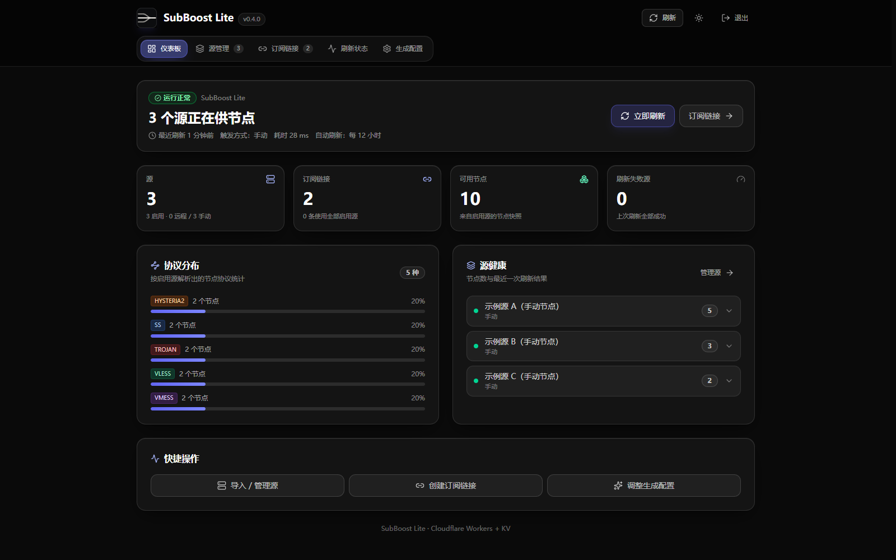
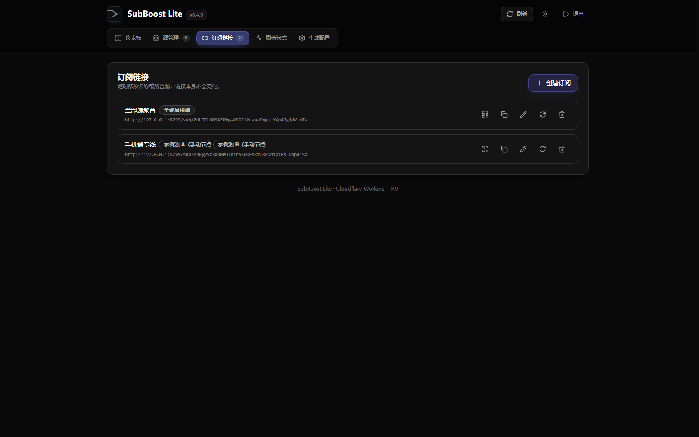
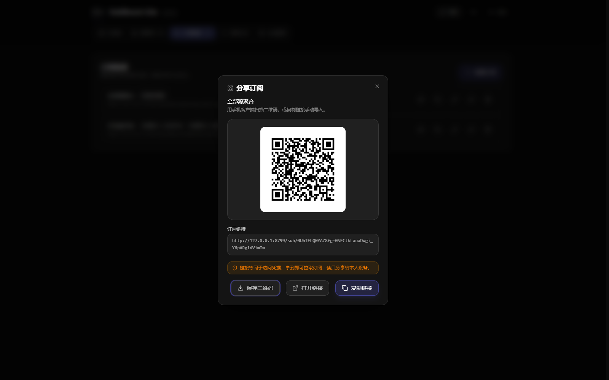
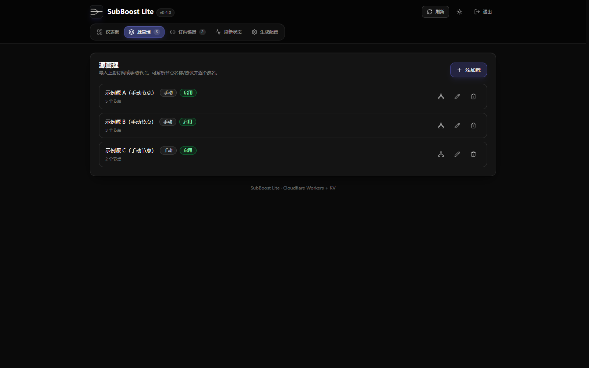
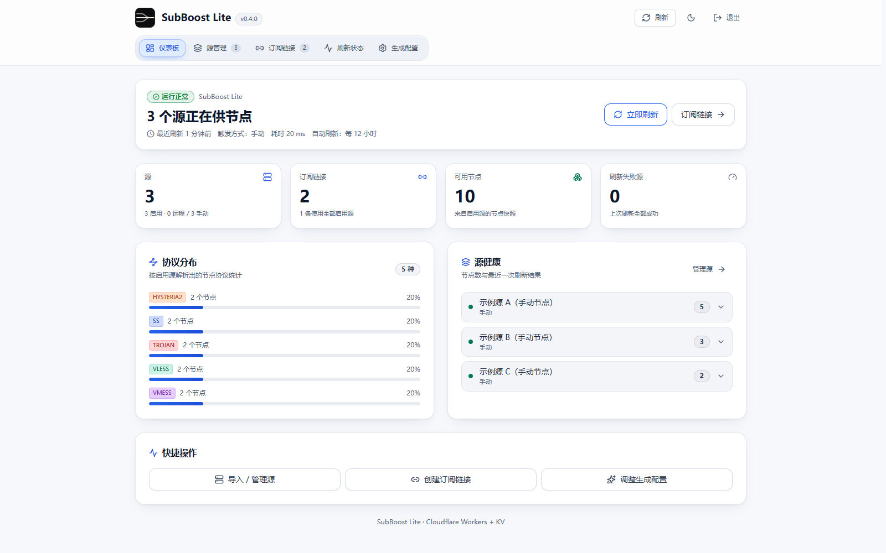
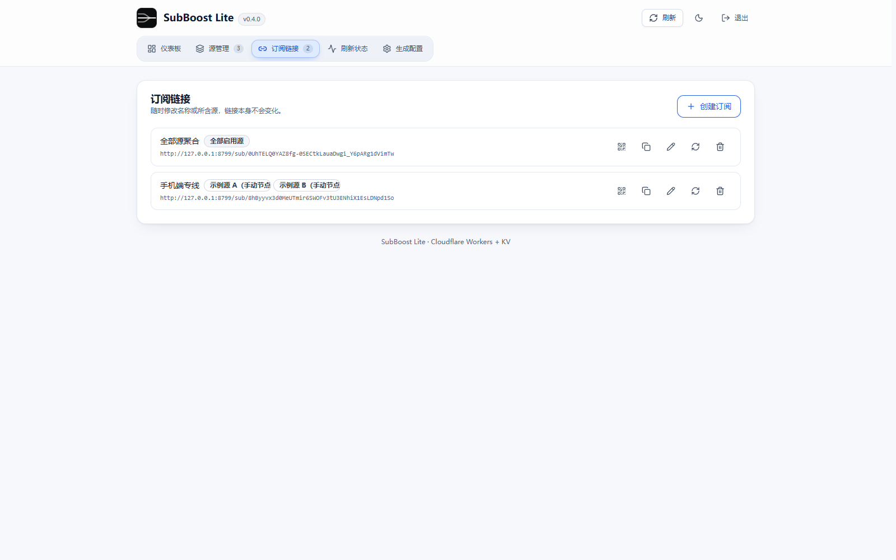
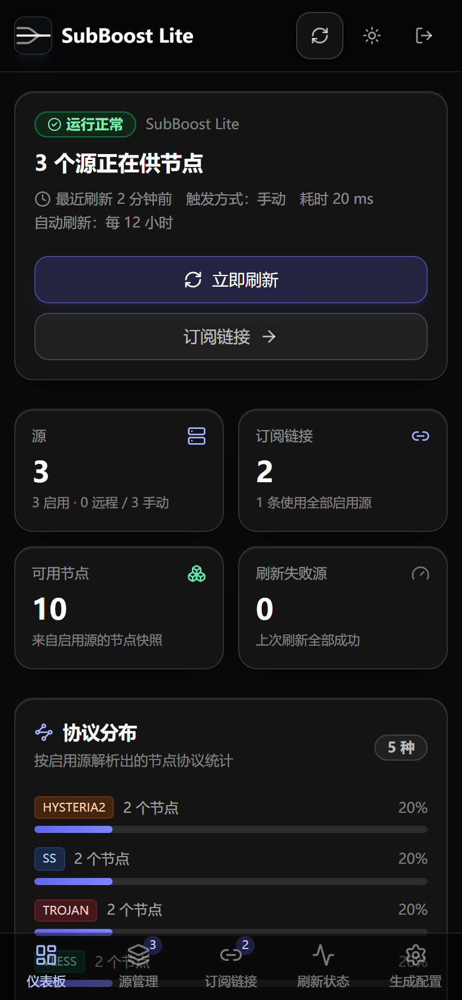
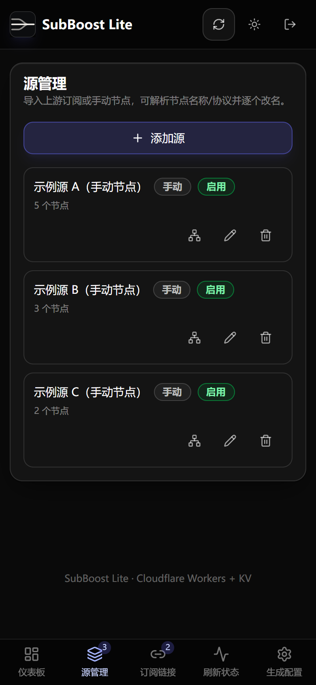
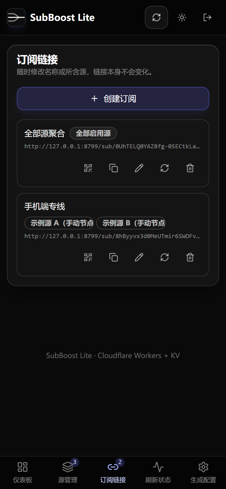

<!-- markdownlint-disable MD033 MD041 -->
<p align="center">
  
</p>

<h1 align="center">SubBoost Worker Lite</h1>

<p align="center">Aggregate several upstream subscriptions and manual nodes into one Clash/Mihomo link, running only on Cloudflare Workers and Workers KV.</p>

<p align="center">
  <a href="./README.en.md">English</a> | <a href="./README.md">简体中文</a>
</p>

<p align="center">
  
  
  <a href="./LICENSE"></a>
</p>
<!-- markdownlint-enable MD033 MD041 -->

**SubBoost Worker Lite** is the minimal deployment form of [SubBoost](https://github.com/SubBoost/subboost). It keeps your upstream subscriptions and manual nodes in Workers KV and serves them as a single Clash/Mihomo link, so you distribute one subscription URL instead of many. There is no server, database, or container to operate.

## Highlights

- **One link to distribute**: several upstream subscriptions plus manually added nodes are merged and deduplicated across sources into a single Clash/Mihomo profile.
- **Admin panel inside the same Worker**: a token-protected SPA manages sources and subscriptions, reports refresh status, and edits the generated config as JSON.
- **Pre-generated cache**: the Cron trigger `0 */12 * * *` fetches upstreams ahead of time, so subscriber requests are answered from KV.
- **Encrypted at rest**: stored payloads such as subscription tokens are encrypted with AES-256-GCM, using a key derived from `ENCRYPTION_KEY` through HKDF-SHA256.
- **Hardened upstream fetching**: scheme and credential validation, private network range blocking, and per-hop redirect checks capped at 3 hops.
- **Nothing cached downstream**: API responses send `cache-control: no-store`, subscription responses are marked `private, no-cache` and advertise the refresh interval, error messages are sanitized, and subscription tokens can be rotated at any time.

## Architecture

```text
  ┌──────────────────┐                  ┌──────────────────────┐
  │ Clash / Mihomo   │                  │ Admin SPA            │
  │ client           │                  │ worker/dist (assets) │
  └───────┬──────────┘                  └───────────┬──────────┘
          │ GET /sub/<token>                        │ /api/* + Bearer token
          ▼                                         ▼
  ┌──────────────────────────────────────────────────────────────────┐
  │ Cloudflare Worker  ·  worker/src                                 │
  │ ADMIN_TOKEN auth  ·  refresh pipeline                            │
  │ Clash / Mihomo YAML output  ·  cache-control: no-store           │
  └───────────────┬──────────────────────────────────┬───────────────┘
                  │ read / write                     │ fetch upstream
                  ▼                                  ▼
  ┌───────────────────────────────┐ ┌────────────────────────────────┐
  │ Workers KV  ·  SUBBOOST_KV    │ │ Upstream subscriptions         │
  │ AES-256-GCM at rest           │ │ SSRF checks, <= 3 redirects    │
  └───────────────▲───────────────┘ └────────────────────────────────┘
                  │ write
  ┌───────────────┴──────────┐
  │ Cron trigger 0 */12 * * *│
  └──────────────────────────┘
```

Clients never contact the upstream providers directly: the Worker fetches them, stores the merged result in KV, and answers `/sub/<token>` from that cache.

## Deployment

Three routes, all ending on a Cloudflare Worker backed by a `SUBBOOST_KV` namespace. Pick one.

### Option A: Fork the repository, then connect it to Cloudflare

Best route if you want a redeploy on every push.

1. Fork this repository to your own GitHub account.
2. In Cloudflare: Workers & Pages → Create → Import a repository, select your fork, and set Production branch to `main`.
3. Keep Root directory as `/` and leave Build command empty, because the `prepare` script builds the admin SPA during install. Set Deploy command to `npm run deploy`.
4. Add the two runtime secrets described below. Pushes to `main` then rebuild and redeploy automatically.

`npm run deploy` runs `node scripts/deploy-worker.cjs`, which reuses or creates the `SUBBOOST_KV` namespace by title and injects its real id into a temporary config. Do not replace it with a bare `npx wrangler deploy`: the committed `wrangler.jsonc` only carries the KV id placeholder, so that command fails.

### Option B: Deploy to Cloudflare button

<a href="https://deploy.workers.cloudflare.com/?url=https://github.com/G1oow/SubBoost-Worker-Lite"></a>

Cloudflare copies this repository into your own GitHub account, creates the Worker named `subboost`, and creates the KV namespace from the binding name. Add the two runtime secrets below afterwards.

### Option C: Deploy from your machine

```bash
npx wrangler login
ADMIN_TOKEN=<32+ random chars> ENCRYPTION_KEY=<32+ random chars> npm run worker:deploy
```

On PowerShell, set `$env:ADMIN_TOKEN` and `$env:ENCRYPTION_KEY` first, then run `npm run worker:deploy`. The script rejects placeholder or short secrets, reuses or creates the `SUBBOOST_KV` namespace by title, injects the real id into a temporary config, uploads both secrets, and deploys. The committed `wrangler.jsonc` keeps the placeholder id.

### Runtime secrets

Options A and B need the two secrets added by hand; Option C uploads them for you. Add them in Worker → Settings → Variables and Secrets with type Secret:

| Secret | Purpose |
| --- | --- |
| `ADMIN_TOKEN` | Login token for the admin panel, 32+ random characters |
| `ENCRYPTION_KEY` | Key for encrypting stored payloads, 32+ random characters |

```bash
node -e "console.log(require('node:crypto').randomBytes(32).toString('base64url'))"
```

Until both exist, admin endpoints fail closed with 503. Changing `ENCRYPTION_KEY` later makes existing data unreadable, so sources and subscriptions must be re-entered. Post-deploy verification and troubleshooting live in [worker/README.md](./worker/README.md).

## Screenshots

### Desktop

Dashboard, dark theme:



Subscription link and QR code sharing, dark theme:

| Subscription link | QR code sharing |
| --- | --- |
|  |  |

Source management, dark theme:



Dashboard and subscriptions, light theme:

| Dashboard | Subscription link |
| --- | --- |
|  |  |

### Mobile

Dashboard, source management, and subscription link at 390 x 844, dark theme:

| Dashboard | Source management | Subscription link |
| --- | --- | --- |
|  |  |  |

Screenshots were captured from a local `wrangler dev` instance using sample sources and reserved domains (`example.com`, RFC 5737 ranges); they contain no real subscriptions or credentials.

## Quick Start

Prerequisites: Node.js 24.22.1 (see `.nvmrc`) and npm. This path needs no Cloudflare account.

```bash
npm ci
cp .dev.vars.example .dev.vars   # fill in random ADMIN_TOKEN and ENCRYPTION_KEY values (32+ chars each)
npm run worker:build
npm run worker:dev               # http://127.0.0.1:8787
```

Open `http://127.0.0.1:8787`, enter the `ADMIN_TOKEN` you configured, add an upstream source, then create a subscription. The subscription is served at `/sub/<token>` as a Clash/Mihomo profile.


## Commands

| Command | What it does |
| --- | --- |
| `npm run worker:dev` | Run the Worker locally on port 8787 |
| `npm run worker:build` | Build the admin SPA into `worker/dist` |
| `npm run worker:deploy` | Build, create or bind KV, upload secrets, deploy |
| `npm run worker:deploy:dry-run` | Validate config and bindings without uploading |
| `npm run worker:typecheck` | Type-check the Worker and the UI |
| `npm run test:unit` | Run all unit and regression tests |
| `npm run lint` | ESLint, UI consistency, repository hygiene, version check |

## Documentation

| Topic | What it covers | Link |
| --- | --- | --- |
| Deployment and operations | Manual deployment steps, post-deploy verification, fork and Workers Builds routes, troubleshooting | [worker/README.md](./worker/README.md) |
| Implementation plan | Design decisions behind the Workers-only form | [docs/implementation/cf-worker-lite-plan.md](./docs/implementation/cf-worker-lite-plan.md) |
| Build record | Conflicts resolved during the port and the acceptance record | [docs/implementation/cf-worker-lite-build.md](./docs/implementation/cf-worker-lite-build.md) |
| Contributing | Issue and PR rules, local checks, UI color rules | [docs/CONTRIBUTING.md](./docs/CONTRIBUTING.md) |
| Third-party notices | Dependency and ecosystem attributions | [docs/THIRD_PARTY_NOTICES.md](./docs/THIRD_PARTY_NOTICES.md) |

## Acknowledgements

- Thanks to the community at [linux.do](https://linux.do) for the feedback and discussion that shaped this deployment form.
- This project builds on upstream [SubBoost](https://github.com/SubBoost/subboost); the parsing, sanitizing, and config-generation logic in `packages/` derives from that work.

## License

[GNU Affero General Public License v3.0 only](./LICENSE).

If you modify this project and run it as a network service, AGPL-3.0 requires you to offer the corresponding source code to those users.

## Disclaimer

This project does not provide any proxy service and makes no guarantee about the availability or legality of third-party subscription content.
