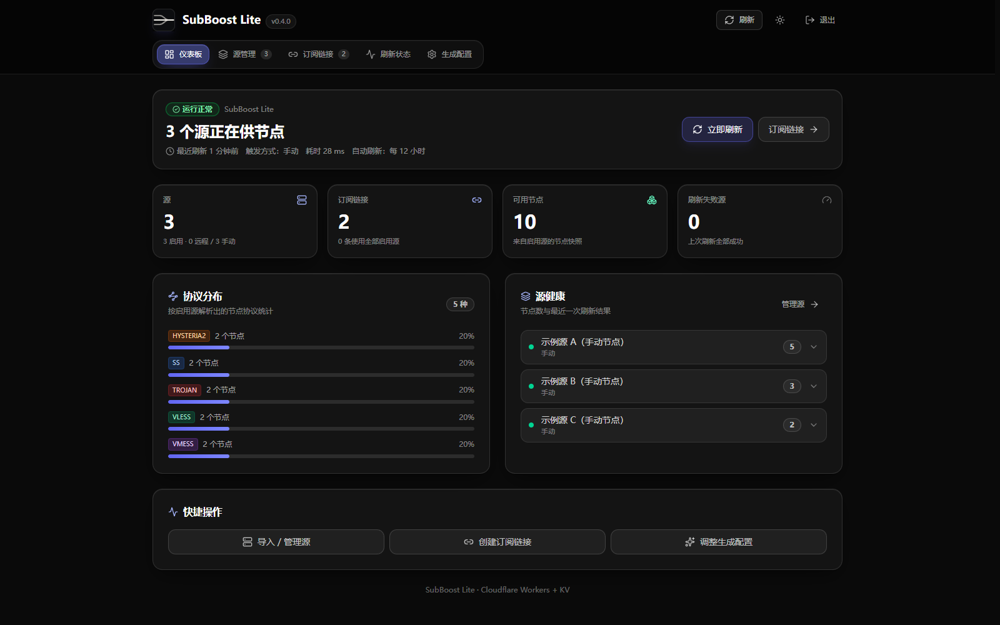
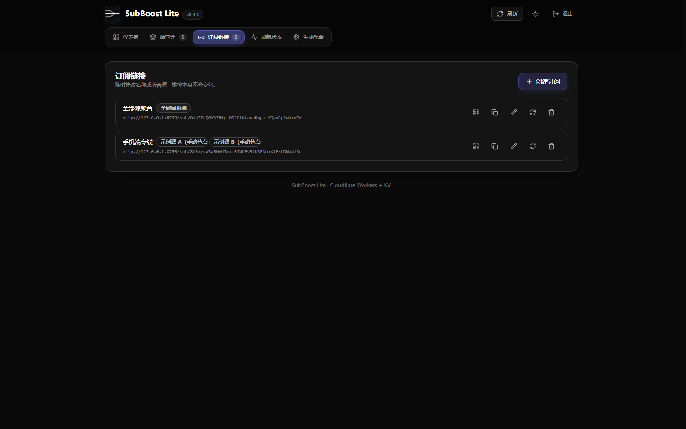
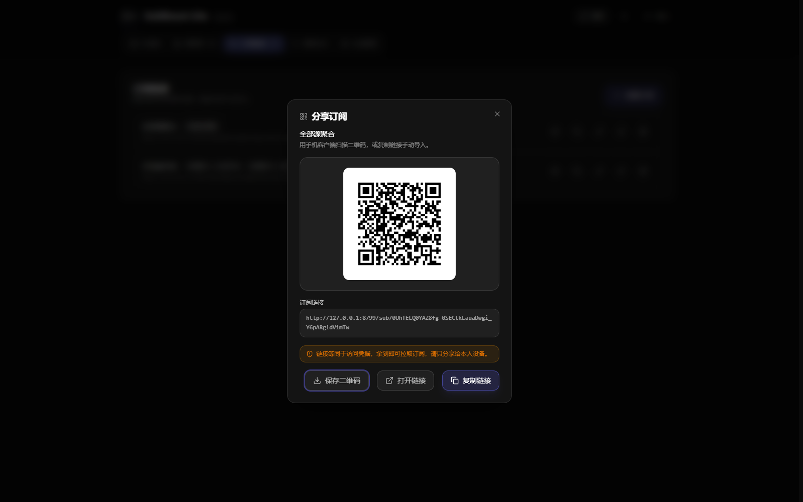
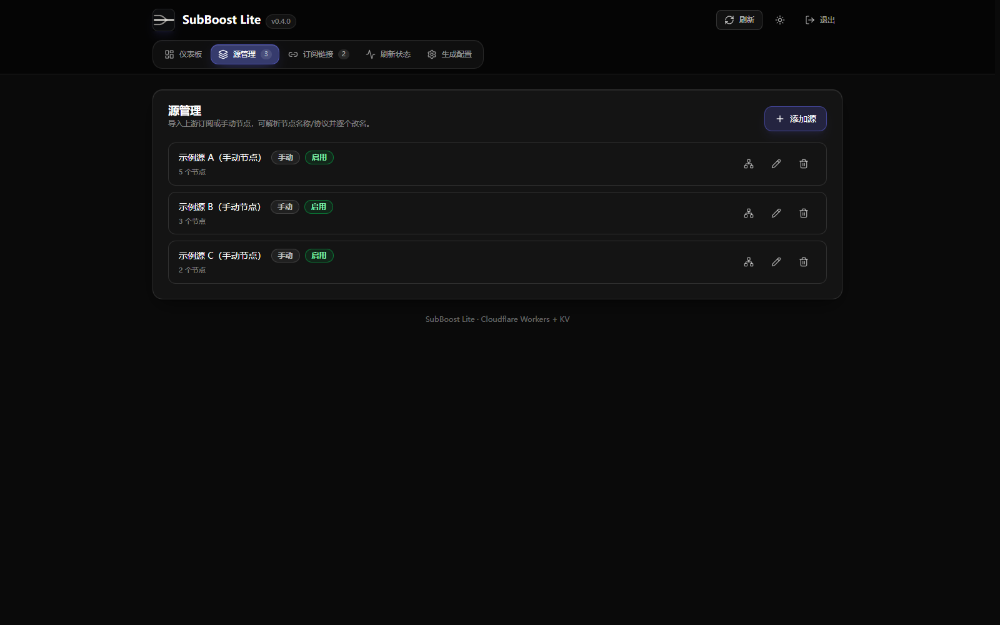
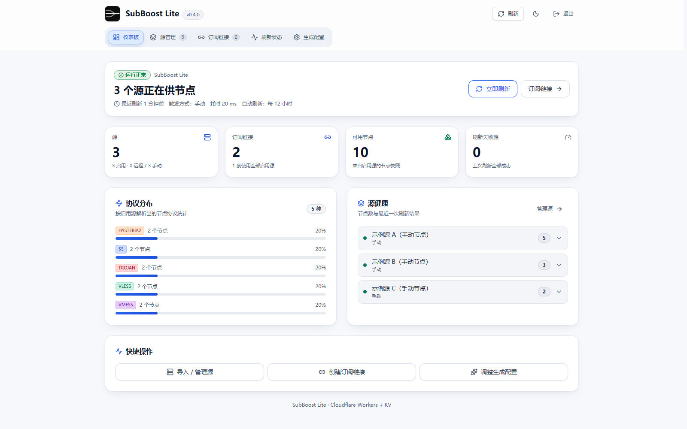
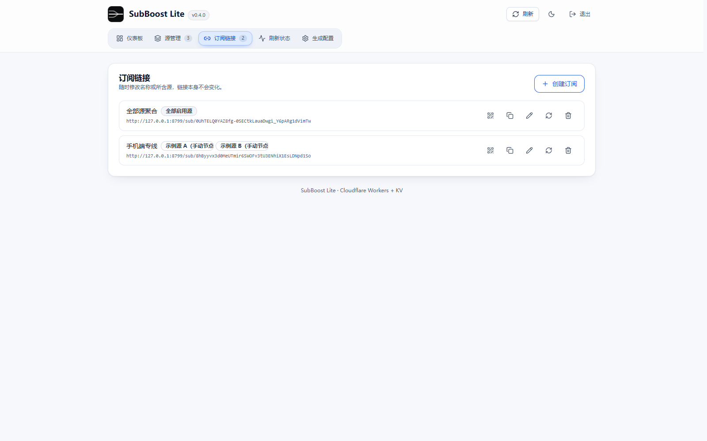
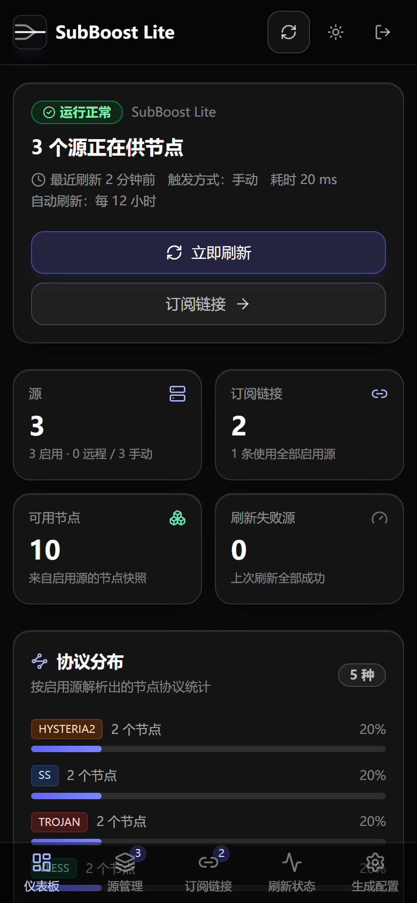
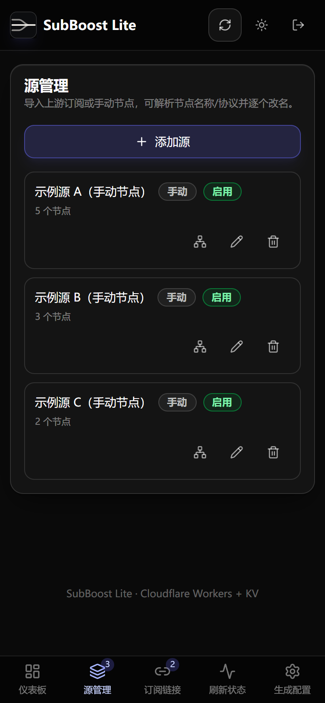
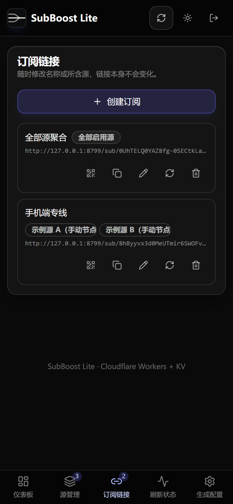

<!-- markdownlint-disable MD033 MD041 -->
<p align="center">
  
</p>

<h1 align="center">SubBoost Worker Lite</h1>

<p align="center">把多个上游订阅与手动节点聚合成一条 Clash/Mihomo 链接，只依赖 Cloudflare Workers 与 Workers KV 运行。</p>

<p align="center">
  <a href="./README.en.md">English</a> | <a href="./README.md">简体中文</a>
</p>

<p align="center">
  
  
  <a href="./LICENSE"></a>
</p>
<!-- markdownlint-enable MD033 MD041 -->

**SubBoost Worker Lite** 是 [SubBoost](https://github.com/SubBoost/subboost) 的精简部署形态。上游订阅与手动节点存放在 Workers KV 中，对外只暴露一条 Clash/Mihomo 订阅链接，因此你分发一个 URL 就够了，不需要维护服务器、数据库或容器。

## 核心特性

- **只维护一条链接**：多个上游订阅与手动添加的节点合并后，跨源去重成一份 Clash/Mihomo 配置。
- **管理端就在同一个 Worker 里**：token 保护的 SPA 负责源管理、订阅管理、刷新状态，并以 JSON 编辑生成的配置。
- **预先生成缓存**：Cron `0 */12 * * *` 提前抓取上游，订阅请求大多直接命中 KV 里的缓存。
- **静态加密**：订阅 token 等落库字段使用 AES-256-GCM 加密，密钥由 `ENCRYPTION_KEY` 经 HKDF-SHA256 派生。
- **抓取侧防护**：协议与凭据校验、私网网段拦截、重定向逐跳校验（最多 3 跳）。
- **不向下游泄漏缓存**：API 响应带 `cache-control: no-store`，订阅响应标记为 `private, no-cache` 并声明刷新间隔；错误信息脱敏，订阅 token 可随时轮换。

## 架构

```text
  ┌──────────────────┐                  ┌──────────────────────┐
  │ Clash / Mihomo   │                  │ Admin SPA            │
  │ client           │                  │ worker/dist (assets) │
  └───────┬──────────┘                  └───────────┬──────────┘
          │ GET /sub/<token>                        │ /api/* + Bearer token
          ▼                                         ▼
  ┌──────────────────────────────────────────────────────────────────┐
  │ Cloudflare Worker  ·  worker/src                                 │
  │ ADMIN_TOKEN auth  ·  refresh pipeline                            │
  │ Clash / Mihomo YAML output  ·  cache-control: no-store           │
  └───────────────┬──────────────────────────────────┬───────────────┘
                  │ read / write                     │ fetch upstream
                  ▼                                  ▼
  ┌───────────────────────────────┐ ┌────────────────────────────────┐
  │ Workers KV  ·  SUBBOOST_KV    │ │ Upstream subscriptions         │
  │ AES-256-GCM at rest           │ │ SSRF checks, <= 3 redirects    │
  └───────────────▲───────────────┘ └────────────────────────────────┘
                  │ write
  ┌───────────────┴──────────┐
  │ Cron trigger 0 */12 * * *│
  └──────────────────────────┘
```

客户端不直接访问上游：Worker 抓取并合并结果写入 KV，`/sub/<token>` 从这份缓存返回。

## 部署

三条路线最终都落在同一个由 `SUBBOOST_KV` 支撑的 Worker 上，选一条即可。

### 方式 A：fork 本仓库后在 Cloudflare 绑定 GitHub 仓库

希望推送即自动重新部署时用这条。

1. 把本仓库 fork 到你自己的 GitHub 账号。
2. Cloudflare 控制台：Workers & Pages → Create → Import a repository，选择你 fork 的仓库，Production branch 填 `main`。
3. Root directory 保持 `/`，Build command 留空（安装依赖时 `prepare` 会构建管理端）。Deploy command 填 `npm run deploy`。
4. 按下方「运行时 Secret」添加两个密钥。之后每次推送 `main` 都会重新构建并部署。

`npm run deploy` 会调用 `node scripts/deploy-worker.cjs`：按标题复用或新建 `SUBBOOST_KV`，把真实 id 注入临时配置后部署。不要换成裸的 `npx wrangler deploy` —— 仓库里的 `wrangler.jsonc` 只保留 KV id 占位符，直接部署会报错。

### 方式 B：一键部署按钮

<a href="https://deploy.workers.cloudflare.com/?url=https://github.com/G1oow/SubBoost-Worker-Lite"></a>

Cloudflare 会把本仓库复制到你自己的 GitHub 账号下，创建名为 `subboost` 的 Worker，并按绑定名自动创建 KV namespace。部署完成后按下方「运行时 Secret」补两个密钥。

### 方式 C：本机命令部署

```bash
npx wrangler login
ADMIN_TOKEN=<32 位以上随机串> ENCRYPTION_KEY=<32 位以上随机串> npm run worker:deploy
```

PowerShell 下先设置 `$env:ADMIN_TOKEN` 与 `$env:ENCRYPTION_KEY`，再执行 `npm run worker:deploy`。脚本会拒绝占位值或过短的密钥，按标题复用或新建 `SUBBOOST_KV`，把真实 id 注入临时配置，上传两个 Secret 后部署；仓库里的 `wrangler.jsonc` 始终保留占位符 id。

### 运行时 Secret

方式 A、B 需要手工添加两个密钥，方式 C 由脚本自动上传。在 Worker → Settings → Variables and Secrets 里以 Secret 类型添加：

| Secret | 作用 |
| --- | --- |
| `ADMIN_TOKEN` | 管理端登录 token，32 位以上随机串 |
| `ENCRYPTION_KEY` | 落库字段的加密密钥，32 位以上随机串 |

```bash
node -e "console.log(require('node:crypto').randomBytes(32).toString('base64url'))"
```

两项缺失时管理接口按 fail closed 返回 503；事后更换 `ENCRYPTION_KEY` 会导致已有数据无法解密，需要重新录入源与订阅。部署后验证与常见报错见 [worker/README.md](./worker/README.md)。

## 界面预览

### 桌面端

仪表板（深色）：



订阅链接与二维码分享（深色）：

| 订阅链接 | 二维码分享 |
| --- | --- |
|  |  |

源管理（深色）：



仪表板与订阅链接（浅色）：

| 仪表板 | 订阅链接 |
| --- | --- |
|  |  |

### 移动端

390 x 844 视口下的仪表板、源管理与订阅链接（深色）：

| 仪表板 | 源管理 | 订阅链接 |
| --- | --- | --- |
|  |  |  |

截图取自本地 `wrangler dev` 实例，使用示例源与保留域名（`example.com`、RFC 5737 网段）演示数据，不含真实订阅或凭据。

## 快速开始

前置：Node.js 24.22.1（见 `.nvmrc`）与 npm。本地运行不需要 Cloudflare 账号。

```bash
npm ci
cp .dev.vars.example .dev.vars   # 填入随机 ADMIN_TOKEN 与 ENCRYPTION_KEY（各 32 位以上）
npm run worker:build
npm run worker:dev               # http://127.0.0.1:8787
```

打开 `http://127.0.0.1:8787`，输入你配置的 `ADMIN_TOKEN` 登录，添加一个上游源，再创建订阅。订阅以 Clash/Mihomo YAML 的形式从 `/sub/<token>` 输出。


## 常用命令

| 命令 | 作用 |
| --- | --- |
| `npm run worker:dev` | 本地运行 Worker（端口 8787） |
| `npm run worker:build` | 构建管理端到 `worker/dist` |
| `npm run worker:deploy` | 构建、建/绑 KV、上传 Secret、部署 |
| `npm run worker:deploy:dry-run` | 只校验配置与绑定，不上传 |
| `npm run worker:typecheck` | Worker 与管理端类型检查 |
| `npm run test:unit` | 全量单元/回归测试 |
| `npm run lint` | ESLint、UI 一致性、仓库卫生、版本校验 |

## 文档

| 主题 | 内容 | 链接 |
| --- | --- | --- |
| 部署与运维 | 手动部署步骤、部署后验证、fork / Workers Builds 流程、常见报错 | [worker/README.md](./worker/README.md) |
| 实施方案 | Workers-only 形态的设计取舍 | [docs/implementation/cf-worker-lite-plan.md](./docs/implementation/cf-worker-lite-plan.md) |
| 构建手册 | 移植过程中处理的冲突与验收记录 | [docs/implementation/cf-worker-lite-build.md](./docs/implementation/cf-worker-lite-build.md) |
| 贡献指南 | Issue / PR 规则、本地校验、UI 颜色约定 | [docs/CONTRIBUTING.md](./docs/CONTRIBUTING.md) |
| 第三方声明 | 依赖与生态归属说明 | [docs/THIRD_PARTY_NOTICES.md](./docs/THIRD_PARTY_NOTICES.md) |

## 致谢

- 感谢 [linux.do](https://linux.do) 社区在讨论与反馈中给出的建议，这套精简部署形态因此得以成形。
- 本项目基于上游 [SubBoost](https://github.com/SubBoost/subboost)，`packages/` 里的解析、清洗与配置生成逻辑源自该项目的实现。

## 许可证

[GNU Affero General Public License v3.0 only](./LICENSE)。

如果你修改本仓库并向网络用户提供服务，AGPL-3.0 要求你向这些用户提供对应的源代码。

## 免责声明

本项目不提供任何代理服务，不对第三方订阅内容的可用性与合法性作任何保证。
